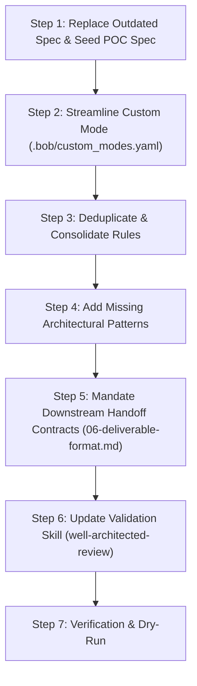

# Enhancement Plan: Hardening `cloud-architect` Mode & Assets for Enterprise AI Benchmark POC

**Target Work Item:** `000-mode-enhancement-for-enterprise-poc`  
**Purpose:** Upgrading custom modes, rules, skills, deliverable contracts, and starter specs so IBM Bob outperforms competing coding agents (Cursor, GitHub Copilot) in the 5-phase client evaluation POC.

---

## 1. Context & POC Evaluation Objectives

The client is evaluating AI Coding Agents (Cursor, GitHub Copilot, IBM Bob) on an end-to-end multi-cloud document processing and data platform.

### POC Scoring Breakdown:
- **Architecture & Design (15%)**: Cloud-agnostic and cloud-specific (AWS, Azure, GCP) architecture, component selection, failure handling, reconciliation.
- **Token Utilization Efficiency (15%)**: Minimizing total prompt + completion token consumption and eliminating tool loops.
- **Integration Readiness & Coverage (15%)**: Snowflake, Snowflake Cortex, Databricks, Apache Iceberg tables, CCL systems.
- **Security & Compliance (10%)**: IAM/RBAC, KMS CMK, secrets management, PII governance, immutable audit logging.
- **Cost Optimization (10%)**: Qualitative cost modeling, storage lifecycles, egress awareness.
- **Functional & Operational Readiness (10%)**: Retry policies, DLQ replay, batch aggregation, reconciliation framework.
- **Code & IaC Generation Enablement (20% - Phases 2 & 3)**: Outputting deterministic interface contracts, schemas, prompts, and folder layouts.
- **Productivity & Delivery Speed (5%)**: Single-pass, zero-rework execution.

---

## 2. Strict Quality Bars (Definition of Done)

Every change made to this repository must meet these acceptance criteria:

1. **Token Efficiency & Zero-Loop Bar**:
   - Eliminate dynamic rule-header inspection loops.
   - Reduce total static rule tokens by $\ge 40\%$ through deduplication.
   - All rules must use dense tables, Mermaid diagrams, and concise constraints (no filler prose).

2. **Downstream Phase 2 & 3 Contract Bar**:
   - The deliverable format in `06-deliverable-format.md` MUST mandate:
     - Exact CloudEvents / JSON Schema for all event payloads.
     - Complete DDL (SQL / NoSQL) for status tracking and reconciliation ledgers.
     - Production-ready prompt specifications (`prompts/document_summary_prompt.yaml`).
     - Target code structure containing `src/`, `terraform/`, `tests/`, `prompts/`, `docs/`, `README.md`.

3. **Missing Architecture Patterns Bar**:
   - **Serverless Batch Aggregation**: Native architectures for AWS (SQS/Step Functions), Azure (Service Bus/Event Hubs), and GCP (Pub/Sub/Cloud Tasks).
   - **Apache Iceberg Interoperability**: Explicit REST Catalog (Polaris / Glue / Unity) + storage credential vending pattern enabling simultaneous Snowflake and Databricks read/write.
   - **Snowflake Cortex Integration**: In-database Cortex AI execution vs. external cloud LLM orchestration.
   - **End-to-End Reconciliation Engine**: Audit ledger schema and discrepancy reconciliation worker.

4. **Multi-Cloud Parity**:
   - AWS, Azure, and GCP documented with 100% feature parity, current service naming, and GA validation.

---

## 3. Step-by-Step Implementation Roadmap



---

### Step 1: Replace Outdated Spec with Canonical POC Spec

**Files to modify/create:**
- Delete or archive: `specs/001-example/`
- Create: `specs/001-doc-processing-platform/spec.md`
- Create: `specs/001-doc-processing-platform/plan.md`
- Create: `specs/001-doc-processing-platform/tasks.md`

#### Requirements for `spec.md`:
- **Business Problem:** Enterprise event-driven document processing with AI summarization and lakehouse integration.
- **In Scope:**
  - Multi-cloud architecture (AWS, Azure, GCP).
  - Storage event triggers $\to$ Messaging Queue $\to$ Serverless Validator.
  - Batch Aggregator for grouping validated files for LLM processing.
  - LLM Summarization Engine (Cloud LLMs + Snowflake Cortex).
  - Lakehouse & Enterprise Integrations: Snowflake, Databricks, Apache Iceberg, CCL systems.
  - Resilience: Exponential backoff retries, DLQ with replay, Reconciliation ledger.
  - Complete security design: IAM/RBAC, KMS CMK, Secrets Manager, PII sanitization.
  - Cost modeling across all components.
- **Tasks & Acceptance Criteria:** Map 1:1 to POC Phase 1 requirements.

---

### Step 2: Streamline `.bob/custom_modes.yaml`

**File to modify:** `.bob/custom_modes.yaml`

#### Changes:
1. Remove instructions telling the agent to read "load when" headers dynamically (eliminates 5–8 preliminary exploratory tool calls).
2. Explicitly bind role, required rules, and grounding behavior in `customInstructions`.
3. Provide concise session initialization rules:
   - Read active spec from `specs/`.
   - Produce single-pass comprehensive architecture deliverable in `docs/`.
   - Ground all cloud services in current documentation.
   - Never generate application code or raw Terraform in Phase 1 (produce architecture and schemas only).

---

### Step 3: Deduplicate & Consolidate Architecture Rules

**Files to modify in `.bob/rules-cloud-architect/`:**
1. `02-multi-cloud-parity.md` & `08-multi-region-ha.md`:
   - Merge the service mapping tables into a single comprehensive matrix covering Compute, Storage, Queues, Events, LLMs, Networking, HA/DR, and Catalogs.
2. `04-architecture-standards.md`:
   - Remove verbatim repetition of skill patterns; provide condensed, actionable pattern selection criteria.
3. `07-cost-optimization.md`:
   - Change cost characterization from "optional unless requested" to **mandatory Cost Model column** in all component matrices (securing full points for Cost Optimization).

---

### Step 4: Add Missing Architectural Patterns

**Files to modify:**
- `.bob/rules-cloud-architect/03-enterprise-integrations.md`
- `.bob/rules-cloud-architect/04-architecture-standards.md`
- `.bob/skills/cloud-architecture-patterns/SKILL.md`

#### Patterns to Add:

#### 1. Serverless Batch Aggregator Pattern
Provide reference architectures for micro-batching asynchronous document uploads before LLM execution:
- **AWS:** S3 Event $\to$ SQS $\to$ Lambda Validator $\to$ DynamoDB Buffer + EventBridge Pipes / Step Functions Distributed Map $\to$ Bedrock Batch Invocation.
- **Azure:** Blob Storage Event $\to$ Event Grid $\to$ Functions Validator $\to$ Cosmos DB / Service Bus Session Batcher $\to$ Azure OpenAI Batch API.
- **GCP:** Cloud Storage Notification $\to$ Pub/Sub $\to$ Cloud Run Validator $\to$ Firestore Buffer / Cloud Tasks $\to$ Vertex AI Batch Prediction.

#### 2. Apache Iceberg Multi-Engine Interoperability Pattern
- **Catalog Architecture:** Apache Polaris REST Catalog / AWS Glue Iceberg Catalog / Databricks Unity Catalog.
- **Access Model:** Storage credential vending (STS / GCP Short-Lived Tokens / Azure SAS) to allow Snowflake and Databricks to read and write directly to Iceberg Parquet files.
- **Schema & Partitioning Strategy:** Partitioning by `ingestion_date` and `doc_type` with hidden partitioning.

#### 3. Snowflake & Snowflake Cortex Integration Pattern
- **Architecture Paths:**
  - *Path A (In-Engine Cortex):* Snowflake SQL / Snowpark calling `SNOWFLAKE.CORTEX.SUMMARIZE` or `COMPLETE` on loaded document text.
  - *Path B (External Cloud LLM):* Cloud-native LLM generates summary, loaded via Snowflake Snowpipe Streaming / Storage Integration.
- **Auth Model:** Snowflake Key-Pair authentication via Secrets Manager.

#### 4. End-to-End Reconciliation & Audit Ledger Pattern
- **Ledger Storage:** Dedicated immutable audit table.
- **Schema:** `(doc_id, correlation_id, sha256_checksum, raw_s3_uri, validation_status, batch_id, llm_status, snowflake_sync_ts, databricks_sync_ts, iceberg_commit_ts, dlq_status)`.
- **Reconciliation Engine:** Scheduled serverless worker running continuous verification (Ingested vs. Validated vs. Processed vs. Committed) with automated discrepancy alerting.

---

### Step 5: Mandate Downstream Handoff Contracts (`06-deliverable-format.md`)

**File to modify:** `.bob/rules-cloud-architect/06-deliverable-format.md`

#### Update Deliverable Specification to Include:
1. **Target Project Layout:**
   ```
   1. src/
      ├── ingestion/
      ├── validation/
      ├── batching/
      ├── llm_engine/
      ├── adapters/
      │   ├── snowflake/
      │   ├── databricks/
      │   ├── iceberg/
      │   └── ccl/
      └── reconciliation/
   2. terraform/
      ├── aws/
      ├── azure/
      └── gcp/
   3. tests/
      ├── unit/
      ├── integration/
      └── failure_scenarios/
   4. prompts/
      └── document_summary_prompt.yaml
   5. docs/
   6. README.md
   ```
2. **Event & Data Contracts:**
   - Ingestion Event Schema (`CloudEvents` format in JSON Schema).
   - Status & Reconciliation Ledger DDL.
   - Processed Summary Output Schema (Parquet / Iceberg DDL).
3. **AI Prompt Specification:**
   - `prompt_template` with variable injection points (`{{document_text}}`, `{{metadata}}`).
   - Hyperparameters: Temperature, Max Output Tokens, Stop Sequences, Model Fallback hierarchy.

---

### Step 6: Update Validation Skill (`well-architected-review`)

**File to modify:** `.bob/skills/well-architected-review/SKILL.md`

#### Add Specific Review Checks:
- **Operational Excellence:** Does the design specify DLQ alert thresholds, dead-letter replay automation, and a scheduled reconciliation worker?
- **Security:** Is PII sanitized before LLM API invocation? Are CMK KMS keys and IAM roles uniquely specified per micro-component?
- **Reliability:** Are batch buffer overflow limits, retry backoff jitter, and circuit breakers explicitly documented?
- **Cost Optimization:** Is the cost model defined for all services (storage tiers, serverless invocations, token costs, egress)?

---

## 4. Verification and Acceptance Testing

To ensure the development agent completed the plan properly, run this validation suite:

1. **Spec Check:** Ensure `specs/001-doc-processing-platform/spec.md` is active and contains all POC requirements.
2. **Static Token Analysis:** Verify rule files are concise and deduplicated.
3. **Execution Dry-Run:** In a fresh session, execute `cloud-architect` against the new spec and verify:
   - Architecture diagrams (Mermaid) cover AWS, Azure, GCP, and Enterprise Integrations.
   - Batch Aggregator, Iceberg Catalog, Cortex, and Reconciliation Ledger are fully specified.
   - The output contains JSON schemas, DDL, prompt specs, and the canonical folder tree.
   - No unnecessary tool loops or file-hunting occurred.
