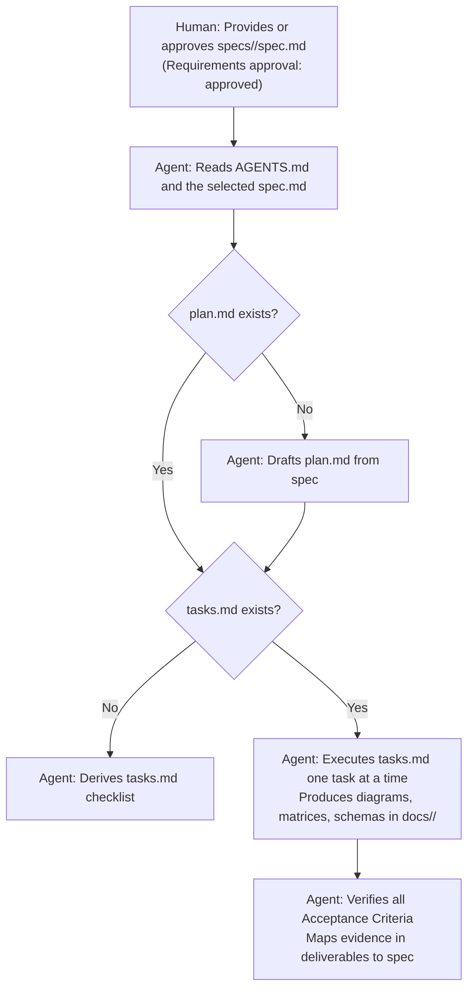
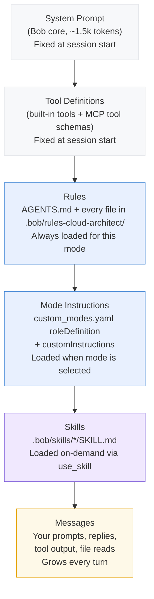

# bob-cloud-architect

A shareable IBM Bob workspace mode for designing production-ready, multi-cloud, event-driven architectures across AWS, Azure, and GCP.

## What this is

The `cloud-architect` mode gives Bob the role of a senior enterprise cloud architect. It produces complete architecture deliverables — diagrams, component selection, security design, integration patterns, data models, and implementation plans — without writing implementation code.

## What it is not

This mode does not generate application code, Terraform, or test suites. For those, see:
- `bob-cloud-codegen` — Python source code generation
- `bob-cloud-iac` — Terraform infrastructure as code
- `bob-cloud-testing` — test suite generation

## Install into your workspace

```bash
npx github:krondor/bob-cloud-architect
```

Or from a local checkout: run `npm install` once in the checkout (the installer needs the `yaml` package), then `node /path/to/bob-cloud-architect/scripts/install.mjs /path/to/your-project`.

By default, the installer copies the mode definition, rules, skills, MCP configuration template (`.bob/mcp.json.example`), `AGENTS.md`, the blank spec template (`specs/TEMPLATE`), and the mode documentation (`README-cloud-architect.md` — renamed so it does not conflict with the project's own `README.md`). It also writes `.bob/cloud-architect.lock.json`, which records a SHA-256 of each installed file. Tests, `package.json`, and repo tooling are never installed into your workspace.

Re-running the installer updates files you have not edited and keeps files you have. Use `--force` to overwrite your edits.

| Option | Effect |
|---|---|
| `--dry-run` | Print what would change; write nothing |
| `--force` | Overwrite locally modified files and replace the existing `cloud-architect` mode entry |
| `--with-examples` | Also install example specs (e.g. `specs/001-doc-processing-platform`). Off by default |
| `--git-exclude` | Add installed paths to `.git/info/exclude` (local-only ignore) |
| `--no-agents` | Skip copying `AGENTS.md` |
| `--no-mcp` | Skip copying `.bob/mcp.json.example` |
| `--no-templates` | Skip copying spec templates (`specs/`) |
| `--no-skills` | Skip copying `.bob/skills/` |
| `--no-rules` | Skip copying `.bob/rules-cloud-architect/` |
| `--no-mode` | Skip updating `.bob/custom_modes.yaml` |
| `--no-readme` | Skip copying mode documentation (`README-cloud-architect.md`) |

## Setup

1. Open the workspace folder in Bob and select **Cloud Architect** in the mode picker.
2. Fill in `AGENTS.md` — replace all `<!-- TODO -->` sections with your engagement's context before starting any session.
3. Optionally configure MCP servers in `.bob/mcp.json` (see `.bob/mcp.json.example` for the template).

## Suggested first prompts

- "Review AGENTS.md and specs/ and tell me what spec is active and what the next task is."
- "The spec is in specs/001-doc-processing-platform/spec.md — start with plan.md."
- "Produce the high-level architecture diagram for the current spec."
- "Produce the component selection matrix for AWS, Azure, and GCP per the spec."

## What the mode produces

1. High-level architecture diagram (Mermaid)
2. Cloud-specific architecture diagrams (one per target cloud)
3. Component selection matrix
4. Enterprise integration architecture
5. Failure handling design (retry, DLQ, reconciliation)
6. Security design (IAM/RBAC, encryption, secrets, audit logging)
7. Recommended folder structure
8. Data models
9. Implementation plan

## Spec-driven workflow & folder structure

All architecture work in this mode is spec-driven. Work items are organized in the `specs/` directory, where each folder represents an isolated engagement, feature, or platform capability:

```
specs/
  ├── TEMPLATE/                         # Starter scaffold (spec.md, plan.md, tasks.md)
  └── 001-doc-processing-platform/      # Engagement folder
      ├── spec.md                       # Requirements & acceptance criteria (Human-authored)
      ├── plan.md                       # Architecture strategy & patterns (Agent-drafted)
      └── tasks.md                      # Ordered deliverable checklist (Agent/Human-managed)
```

### The 3-file spec lifecycle

| File | Primary Owner | Purpose | Division of Labor |
|---|---|---|---|
| **`spec.md`** | **Human** (agent may draft if missing) | **The "What & Why"** | Defines business problem, scope boundaries, target clouds, integration targets, constraints, and testable acceptance criteria. The agent never invents business requirements: a drafted spec lists unknowns as open decisions and stays `Requirements approval: pending` until a human approves it. |
| **`plan.md`** | **Agent** (Human reviews) | **The "How"** | High-level architectural strategy, selected design patterns (Saga, Outbox, Batch Aggregator), cloud selection rationale, security posture, and open decisions. Drafted automatically by the agent if missing. |
| **`tasks.md`** | **Agent / Human** | **The Checklist** | Ordered, reviewable deliverable items derived from `spec.md` scope (e.g. Task 1: Mermaid diagrams, Task 2: Component matrix, Task 3: Security design). Executed one task at a time. |

### How Bob processes specs

When starting a session in `cloud-architect` mode, Bob selects the spec, checks that a human has approved its requirements, ensures supporting planning documents exist, and executes deliverables sequentially. Status (`draft`, `in-progress`, `ready-for-review`, `accepted`) tracks progress; `Requirements approval` is a separate field, set only by a human and recorded against a revision.



## Review before use

- **Not yet run against a real engagement.** Mode YAML syntax has been validated; first pilot run is the real test.
- **AGENTS.md has placeholder sections.** Fill them in before running any real architecture session.
- **MCP servers are optional.** Cloud documentation MCPs (AWS, Azure, GCP) improve component selection accuracy but are not required. See `.bob/mcp.json.example` for configuration.

## How Bob processes this workspace

Understanding what Bob loads — and when — helps you decide where to put new guidance. Bob's context window is limited (Bob's documentation cites 200,000–270,000 tokens depending on the page; check your Bob version), and every configuration layer consumes part of it before you type your first prompt.

### Context window loading order



**Key insight:** System prompt, tool definitions, rules, and mode instructions are all fixed overhead — they consume tokens before you send a single message. Bob loads **every** file in `.bob/rules-cloud-architect/` and combines it with the mode's `customInstructions`; a comment in a rules file does not defer loading. Skills are the only layer that is demand-loaded mid-session, which is why deep reference content belongs in skills rather than rules.

### Rule loading order

Per Bob's documentation, rules are combined in this order: global rules (`~/.bob/rules/`), then workspace rules (`.bob/rules/`). Within each level, mode-specific rules (`rules-<mode>/`) load before general rules. `AGENTS.md` loads after mode-specific rules and before general workspace rules. Workspace rules can override global rules. Files within a directory load alphabetically.

### What belongs where

Use this table to decide where to put new guidance:

| I want to… | Put it in… | Why |
|---|---|---|
| Define the agent's identity, what it produces, and what it never does | `custom_modes.yaml` → `roleDefinition` | Loaded every session; sets the persona |
| Give the agent procedural instructions for every session (workflow, hard constraints, dispatch) | `custom_modes.yaml` → `customInstructions` | Loaded every session; governs behavior |
| Define a constraint that applies to every task in this mode (security, output format, cost model) | `.bob/rules-cloud-architect/NN-name.md` | Always loaded for this mode — every line costs tokens every session |
| Record organizational context the agent needs every session (target clouds, approved services, naming conventions) | `AGENTS.md` | Auto-loaded; version-controlled; shared with the team |
| Give the agent a deep reference for a specialist task (pattern catalog, WAF review checklist) | `.bob/skills/<name>/SKILL.md` | Demand-loaded via `use_skill` — zero cost until needed |
| Add grounded, live documentation lookup for a cloud provider | `.bob/mcp.json` (MCP server) | Tools are available throughout the session; only schemas count toward fixed overhead |
| Block or intercept a tool call, or run a command automatically after an event | `.bob/settings.json` → `hooks` | System-level enforcement — runs outside the agent's context |
| Record where skills came from and pin their versions | `skills-lock.json` | Reproducibility and audit trail |

### When to use each configuration type

#### `roleDefinition` vs `customInstructions`
`roleDefinition` is the agent's identity — who it is, what it specializes in, and what it never does. Keep it to a paragraph. `customInstructions` is procedural — the session start checklist, spec-driven workflow steps, MCP grounding procedure, and hard constraints. Both load every session, so neither should contain reference content (patterns, checklists, service mappings). Move that to a rules file or skill.

#### Rules files vs `AGENTS.md`
`AGENTS.md` is for context that applies to every mode in the workspace: workflow, team conventions, approved services, open decisions. Rules files in `.bob/rules-cloud-architect/` apply to every task in this mode. Anything that only some tasks need belongs in a skill, not a rules file.

**Keep `AGENTS.md` short.** It loads on every turn. Every sentence costs tokens throughout the entire session.

#### Rules files vs skills
Rules are always loaded; skills load on demand:

| | Rules file | Skill |
|---|---|---|
| Format | Markdown | `SKILL.md` with YAML front matter |
| How loaded | Automatically, with the mode, every session | `use_skill` tool call |
| Best for | Prescriptive constraints, output formats, required fields, mapping tables | Deep reference content, decision trees, pattern catalogs, review checklists |
| Token cost | Counted in **Rules** category | Counted in **Skills** category |
| Example in this mode | `05-security-design.md` — required IAM/encryption fields | `well-architected-review` — 5-pillar review questions |

#### Hooks
Hooks run shell commands or HTTP requests at Bob lifecycle events (`PreToolUse`, `PostToolUse`, `SessionStart`, `Stop`, etc.). They operate **outside the agent's context window** — they cannot read or write the conversation, but they can block tool calls, run linters, or post audit events to external systems.

**This mode has no hooks.** The mode's permission groups do not include `execute`, so the agent cannot run shell commands. That removes shell risk only: the mode still has unrestricted `edit`, plus `mcp`, `subagent`, and `mode`, so file edits and configured MCP tools can still change things. If you add `execute` to the groups (e.g. to allow `git` commands), add a `PreToolUse` hook to block any shell patterns that could cause harm.

Add hooks in `.bob/settings.json`:
```json
{
  "hooks": {
    "PostToolUse": [
      {
        "matcher": "^(write_file|apply_diff)$",
        "hooks": [{ "type": "command", "command": "node .bob/hooks/my-hook.mjs" }]
      }
    ]
  }
}
```

See the [Bob hooks documentation](https://www.ibm.com/docs/bob) for the full event reference.

---

## Local customization

Everything below assumes you have cloned this repo locally and are editing it directly — no git workflow required.

### Fill in AGENTS.md

`AGENTS.md` is loaded at the start of every session. Replace every `<!-- TODO -->` block with your context: target clouds, integration targets, approved LLM services, organization naming conventions, and compliance requirements. Keep it short — it loads every session. Reference content (patterns, examples, detailed rules) belongs in rules files, not here.

### Add a skill

A skill is a `SKILL.md` file that Bob loads via `use_skill`. To add one:

1. Create the directory: `.bob/skills/<skill-name>/`
2. Place the `SKILL.md` file inside it — source it from a GitHub raw URL, copy from another repo, or write your own.
3. Register it in the **Skills** table in `AGENTS.md`: name, path, and when to use it.
4. Record the source URL and version in `skills-lock.json` under `"skills"` so it is reproducible.

### Edit or add a rules file

Rules files live in `.bob/rules-cloud-architect/`. Bob loads every file there automatically, in alphabetical order, so keep them short and universal. Edit any file freely.

To add a new rule:
1. Create `.bob/rules-cloud-architect/NN-name.md`. It is loaded automatically; no registration is needed.
2. If it applies only to some tasks, make it a skill instead.

### Configure MCP servers

Copy `.bob/mcp.json.example` to `.bob/mcp.json`. The mode has three documentation MCP servers pre-configured. Each has different prerequisites:

| Server | Auth required | Prerequisites |
|---|---|---|
| **AWS** (`awslabs.aws-documentation-mcp-server`) | None | Install [`uv`](https://docs.astral.sh/uv/getting-started/installation/), then run `uv python install 3.10`. The server starts automatically via `uvx`. |
| **Microsoft Learn** (`microsoft-learn`) | None | Nothing — remote HTTP connection to `learn.microsoft.com`. Works immediately after copying the file. |
| **Google Developer Knowledge** (`google-developer-knowledge`) | API key | See below. |

#### Google Developer Knowledge API key setup

1. Open [console.cloud.google.com](https://console.cloud.google.com) and select or create a project.
2. Enable the API: run `gcloud services enable developerknowledge.googleapis.com --project=PROJECT_ID`, or open the [Developer Knowledge API page](https://console.cloud.google.com/start/api?id=developerknowledge.googleapis.com) and click **Enable**.
3. Create an API key: go to [console.cloud.google.com/apis/credentials](https://console.cloud.google.com/apis/credentials), click **Create credentials → API key**.
4. Restrict the key: click **Edit API key → API restrictions → Restrict key**, select **Developer Knowledge API**, click **Save**.
5. Copy the key string and replace `YOUR_GCP_API_KEY` in `.bob/mcp.json`.

`.bob/mcp.json` is git-ignored — it stays local. Never commit it.

**Corporate networks:** if your proxy blocks the default User-Agent, add `"MCP_USER_AGENT": "<your-browser-UA>"` to the `env` block of the AWS server entry.

### Starting a new engagement / spec

An example spec lives in `specs/001-doc-processing-platform/spec.md`. To start a new architecture engagement:
1. Copy `specs/TEMPLATE/` to a new folder (e.g. `specs/002-my-platform/`).
2. Fill in `spec.md` with your business problem, scope, target clouds, integrations, and acceptance criteria. Review it, then set `Requirements approval` to `approved by <name> on <date> at <revision>`. Or skip this step: describe the system to the agent and it drafts the spec for your approval.
3. You only need to author or approve `spec.md`. When you start your session in Bob, the agent reads it and drafts `plan.md` and `tasks.md` for your review before generating deliverables.

## Contributing via git

See [CONTRIBUTING.md](CONTRIBUTING.md).

## Sources

- Pattern: [krondor/bob-tofu-spacelift](https://github.com/krondor/bob-tofu-spacelift)
- AWS Documentation MCP: [awslabs/aws-documentation-mcp-server](https://awslabs.github.io/mcp/servers/aws-documentation-mcp-server)
- Microsoft Learn MCP: [MicrosoftDocs/mcp](https://github.com/microsoftdocs/mcp)
- Google Developer Knowledge MCP: [developers.google.com/knowledge/mcp](https://developers.google.com/knowledge/mcp)
