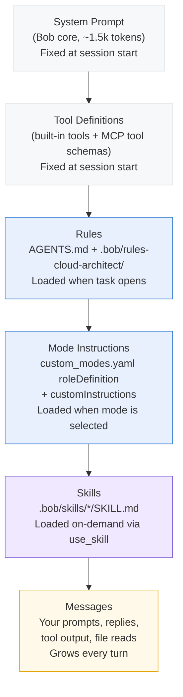

# bob-cloud-architect

A shareable IBM Bob workspace mode for designing production-ready, multi-cloud, event-driven architectures across AWS, Azure, and GCP.

## What this is

The `cloud-architect` mode gives Bob the role of a senior enterprise cloud architect. It produces complete architecture deliverables — diagrams, component selection, security design, integration patterns, data models, and implementation plans — without writing implementation code.

## What it is not

This mode does not generate application code, Terraform, or test suites. For those, see:
- `bob-cloud-codegen` — Python source code generation
- `bob-cloud-iac` — Terraform infrastructure as code
- `bob-cloud-testing` — test suite generation

## Install into your workspace

```bash
npx github:krondor/bob-cloud-architect
```

Or from a local checkout: `node /path/to/bob-cloud-architect/scripts/install.mjs /path/to/your-project`

| Option | Effect |
|---|---|
| `--dry-run` | Print what would change; write nothing |
| `--with-templates` | Also copy `AGENTS.md` if it does not already exist |
| `--force` | Replace an existing `cloud-architect` block in `custom_modes.yaml` |

## Setup

1. Open the workspace folder in Bob and select **Cloud Architect** in the mode picker.
2. Fill in `AGENTS.md` — replace all `<!-- TODO -->` sections with your engagement's context before starting any session.
3. Optionally configure MCP servers in `.bob/mcp.json` (see `.bob/mcp.json.example` for the template).

## Suggested first prompts

- "Review AGENTS.md and specs/ and tell me what spec is active and what the next task is."
- "The spec is in specs/001-example/spec.md — start with plan.md."
- "Produce the high-level architecture diagram for the current spec."
- "Produce the component selection matrix for AWS, Azure, and GCP per the spec."

## What the mode produces

1. High-level architecture diagram (Mermaid)
2. Cloud-specific architecture diagrams (one per target cloud)
3. Component selection matrix
4. Enterprise integration architecture
5. Failure handling design (retry, DLQ, reconciliation)
6. Security design (IAM/RBAC, encryption, secrets, audit logging)
7. Recommended folder structure
8. Data models
9. Implementation plan

## Review before use

- **Not yet run against a real engagement.** Mode YAML syntax has been validated; first pilot run is the real test.
- **AGENTS.md has placeholder sections.** Fill them in before running any real architecture session.
- **MCP servers are optional.** Cloud documentation MCPs (AWS, Azure, GCP) improve component selection accuracy but are not required. See `.bob/mcp.json.example` for configuration.

## How Bob processes this workspace

Understanding what Bob loads — and when — helps you decide where to put new guidance. Bob has a fixed context window of **270,000 tokens**. Every configuration layer consumes part of it before you type your first prompt.

### Context window loading order



**Key insight:** System prompt, tool definitions, rules, and mode instructions are all fixed overhead — they consume tokens before you send a single message. Keep them lean. Skills are the only layer that is demand-loaded mid-session, which is why this mode uses them for deep reference content rather than loading everything upfront.

### Rule priority (highest → lowest)

Bob combines rules from multiple sources. Workspace rules override global rules; mode-specific rules load before general rules.

```
1. Global mode rules      ~/.bob/rules-<mode>/    (your personal overrides, all workspaces)
2. Workspace mode rules   .bob/rules-cloud-architect/   ← this repo
3. Global general rules   ~/.bob/rules/
4. Workspace general      .bob/rules/
5. AGENTS.md              loaded after mode rules, before workspace general rules
```

This means rules in `.bob/rules-cloud-architect/` take precedence over anything in `.bob/rules/` and will be overridden only by rules you place in your global `~/.bob/rules-cloud-architect/`.

### What belongs where

Use this table to decide where to put new guidance:

| I want to… | Put it in… | Why |
|---|---|---|
| Define the agent's identity, what it produces, and what it never does | `custom_modes.yaml` → `roleDefinition` | Loaded every session; sets the persona |
| Give the agent procedural instructions for every session (workflow, hard constraints, dispatch) | `custom_modes.yaml` → `customInstructions` | Loaded every session; governs behavior |
| Define grounding rules for a specific architecture domain (security, HA, cost, integrations) | `.bob/rules-cloud-architect/NN-name.md` with a `<!-- load when: -->` header | Loaded on-demand only — keeps fixed overhead low |
| Record organizational context the agent needs every session (target clouds, approved services, naming conventions) | `AGENTS.md` | Auto-loaded; version-controlled; shared with the team |
| Give the agent a deep reference for a specialist task (pattern catalog, WAF review checklist) | `.bob/skills/<name>/SKILL.md` | Demand-loaded via `use_skill` — zero cost until needed |
| Add grounded, live documentation lookup for a cloud provider | `.bob/mcp.json` (MCP server) | Tools are available throughout the session; only schemas count toward fixed overhead |
| Block or intercept a tool call, or run a command automatically after an event | `.bob/settings.json` → `hooks` | System-level enforcement — runs outside the agent's context |
| Record where skills came from and pin their versions | `skills-lock.json` | Reproducibility and audit trail |

### When to use each configuration type

#### `roleDefinition` vs `customInstructions`
`roleDefinition` is the agent's identity — who it is, what it specializes in, and what it never does. Keep it to a paragraph. `customInstructions` is procedural — the session start checklist, spec-driven workflow steps, MCP grounding procedure, and hard constraints. Both load every session, so neither should contain reference content (patterns, checklists, service mappings). Move that to a rules file or skill.

#### Rules files vs `AGENTS.md`
`AGENTS.md` is for context that is always relevant: workflow, team conventions, approved services, open decisions. Rules files are for domain-specific guidance that is only relevant when the agent is doing a specific type of work. A security design rule is useless overhead during a diagram task — put it in `05-security-design.md` with a `<!-- load when: -->` header, not in `AGENTS.md`.

**Keep `AGENTS.md` short.** It loads on every turn. Every sentence costs tokens throughout the entire session.

#### Rules files vs skills
Both are on-demand, but they serve different purposes:

| | Rules file | Skill |
|---|---|---|
| Format | Markdown with `<!-- load when: -->` header | `SKILL.md` with YAML front matter |
| How loaded | Agent reads file via `read_file` | `use_skill` tool call |
| Best for | Prescriptive constraints, output formats, required fields, mapping tables | Deep reference content, decision trees, pattern catalogs, review checklists |
| Token cost | Counted in **Rules** category | Counted in **Skills** category |
| Example in this mode | `05-security-design.md` — required IAM/encryption fields | `well-architected-review` — 5-pillar review questions |

#### Hooks
Hooks run shell commands or HTTP requests at Bob lifecycle events (`PreToolUse`, `PostToolUse`, `SessionStart`, `Stop`, etc.). They operate **outside the agent's context window** — they cannot read or write the conversation, but they can block tool calls, run linters, or post audit events to external systems.

**This mode has no hooks.** The mode's permission groups do not include `execute`, so the agent cannot run shell commands. There is no blast radius that a hook needs to guard against. If you add `execute` to the groups (e.g. to allow `git` commands), add a `PreToolUse` hook to block any shell patterns that could cause harm.

Add hooks in `.bob/settings.json`:
```json
{
  "hooks": {
    "PostToolUse": [
      {
        "matcher": "^(write_file|apply_diff)$",
        "hooks": [{ "type": "command", "command": "node .bob/hooks/my-hook.mjs" }]
      }
    ]
  }
}
```

See the [Bob hooks documentation](https://www.ibm.com/docs/bob) for the full event reference.

---

## Local customization

Everything below assumes you have cloned this repo locally and are editing it directly — no git workflow required.

### Fill in AGENTS.md

`AGENTS.md` is loaded at the start of every session. Replace every `<!-- TODO -->` block with your context: target clouds, integration targets, approved LLM services, organization naming conventions, and compliance requirements. Keep it short — it loads every session. Reference content (patterns, examples, detailed rules) belongs in rules files, not here.

### Add a skill

A skill is a `SKILL.md` file that Bob loads via `use_skill`. To add one:

1. Create the directory: `.bob/skills/<skill-name>/`
2. Place the `SKILL.md` file inside it — source it from a GitHub raw URL, copy from another repo, or write your own.
3. Register it in the **Skills** table in `AGENTS.md`: name, path, and when to use it.
4. Record the source URL and version in `skills-lock.json` under `"skills"` so it is reproducible.

### Edit or add a rules file

Rules files live in `.bob/rules-cloud-architect/`. Each file begins with `<!-- load when: ... -->` — that comment tells the agent when to load it. Edit any file freely.

To add a new rules domain (e.g. cost optimization):
1. Create `.bob/rules-cloud-architect/NN-name.md` with a `<!-- load when: ... -->` header.
2. Add a matching entry in the dispatch table inside `.bob/custom_modes.yaml` under `customInstructions` so the agent knows when to load it.

### Configure MCP servers

Copy `.bob/mcp.json.example` to `.bob/mcp.json`. The mode has three documentation MCP servers pre-configured. Each has different prerequisites:

| Server | Auth required | Prerequisites |
|---|---|---|
| **AWS** (`awslabs.aws-documentation-mcp-server`) | None | Install [`uv`](https://docs.astral.sh/uv/getting-started/installation/), then run `uv python install 3.10`. The server starts automatically via `uvx`. |
| **Microsoft Learn** (`microsoft-learn`) | None | Nothing — remote HTTP connection to `learn.microsoft.com`. Works immediately after copying the file. |
| **Google Developer Knowledge** (`google-developer-knowledge`) | API key | See below. |

#### Google Developer Knowledge API key setup

1. Open [console.cloud.google.com](https://console.cloud.google.com) and select or create a project.
2. Enable the API: run `gcloud services enable developerknowledge.googleapis.com --project=PROJECT_ID`, or open the [Developer Knowledge API page](https://console.cloud.google.com/start/api?id=developerknowledge.googleapis.com) and click **Enable**.
3. Create an API key: go to [console.cloud.google.com/apis/credentials](https://console.cloud.google.com/apis/credentials), click **Create credentials → API key**.
4. Restrict the key: click **Edit API key → API restrictions → Restrict key**, select **Developer Knowledge API**, click **Save**.
5. Copy the key string and replace `YOUR_GCP_API_KEY` in `.bob/mcp.json`.

`.bob/mcp.json` is git-ignored — it stays local. Never commit it.

**Corporate networks:** if your proxy blocks the default User-Agent, add `"MCP_USER_AGENT": "<your-browser-UA>"` to the `env` block of the AWS server entry.

### Update the spec template

An example spec lives in `specs/001-example/spec.md`. Copy `specs/TEMPLATE/spec.md` to a new directory (e.g. `specs/my-project/`) and fill it in. The agent reads specs at session start — the active spec drives what it produces.

## Contributing via git

See [CONTRIBUTING.md](CONTRIBUTING.md).

## Sources

- Pattern: [krondor/bob-tofu-spacelift](https://github.com/krondor/bob-tofu-spacelift)
- AWS Documentation MCP: [awslabs/aws-documentation-mcp-server](https://awslabs.github.io/mcp/servers/aws-documentation-mcp-server)
- Microsoft Learn MCP: [MicrosoftDocs/mcp](https://github.com/microsoftdocs/mcp)
- Google Developer Knowledge MCP: [developers.google.com/knowledge/mcp](https://developers.google.com/knowledge/mcp)
